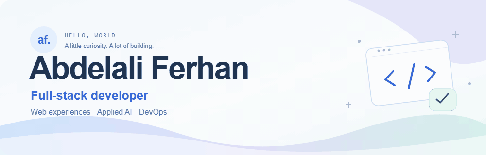
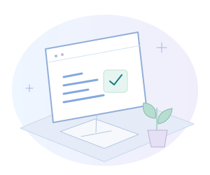
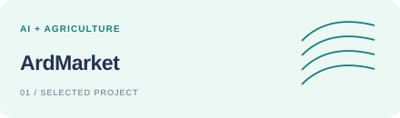
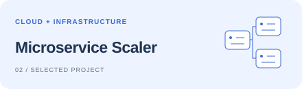
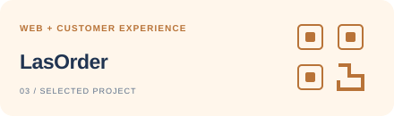
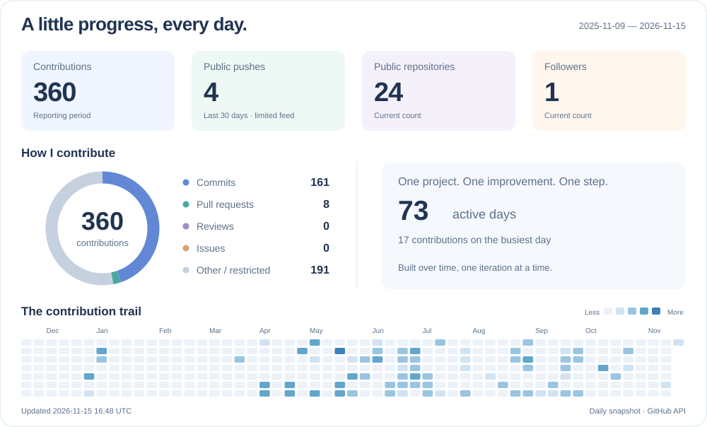

  <picture>
    <source media="(max-width: 600px)" srcset="./assets/hero-mobile.svg" />
    <source media="(prefers-reduced-motion: reduce)" srcset="./assets/hero-static.svg" />
    
  </picture>

  <b>Turning ideas into useful, thoughtfully built software.</b> 
  Based in Fès, Morocco · Learning, building, and sharing along the way.

  
  &nbsp;
  
  &nbsp;
  

  
  &nbsp;
  

  <a href="#a-little-about-me">About</a> &nbsp; · &nbsp;
  <a href="#my-toolkit">Toolkit</a> &nbsp; · &nbsp;
  <a href="#selected-projects">Projects</a> &nbsp; · &nbsp;
  <a href="#my-github-at-a-glance">Activity</a> &nbsp; · &nbsp;
  <a href="#lets-connect">Contact</a>

## A little about me

Hi, I'm **Abdelali** — a full-stack developer who enjoys connecting a clear user experience with the engineering behind it.

I'm studying computer engineering at **ENIAD Berkane**, after a **DUT in Computer Science at EST Fès**. My projects bring together web development, intelligent features, and the infrastructure that keeps everything running.

- **Building:** web applications, AI-powered tools, and containerized services.
- **Exploring:** AI, system design, and software architecture.
- **Looking for:** interesting collaborations and freelance projects.

I like asking good questions, making complex workflows easier to use, and learning something with every project.

 

## My toolkit

  
    
  

  <b>Interfaces</b> &nbsp; React · Angular · Next.js 
  <b>Services</b> &nbsp; Spring Boot · Laravel · Node.js · Flask · FastAPI 
  <b>AI interests</b> &nbsp; Machine learning · NLP · Computer vision 
  <b>Delivery</b> &nbsp; Docker · Nginx · CI/CD

## Selected projects

A few things I've enjoyed bringing to life. More demos and project details live in **[my portfolio](https://abdoutrdfer.github.io/portfolio/)**.

<table>
  <tr>
    <td width="50%" valign="top">
      
      
<b>ArdMarket</b> An agricultural land marketplace with Darija voice input and document recognition.

      
<code>React</code> <code>FastAPI</code> <code>Firebase</code>

      <a href="https://github.com/AbdouTrdFer/ArdMarket">View repository →</a>
    </td>
    <td width="50%" valign="top">
      
      
<b>Microservice Scaler</b> Container monitoring, horizontal scaling, and load balancing for adaptable services.

      
<code>Docker</code> <code>Flask</code> <code>Nginx</code>

      <a href="https://github.com/AbdouTrdFer/Dynamic-Microservice-Scaler">View repository →</a>
    </td>
  </tr>
  <tr>
    <td width="50%" valign="top">
      
      
<b>LasOrder</b> A QR-code restaurant ordering flow, from the menu and cart to order management and analytics.

      
<code>Laravel</code> <code>React</code> <code>Chart.js</code>

      <a href="https://abdoutrdfer.github.io/portfolio/">Explore in my portfolio →</a>
    </td>
    <td width="50%" valign="top">
      
      
<b>E-learning Platform</b> Courses, quizzes, messaging, and learner progress for students, teachers, and administrators.

      
<code>Laravel</code> <code>Node.js</code> <code>MongoDB</code>

      <a href="https://abdoutrdfer.github.io/portfolio/">Explore in my portfolio →</a>
    </td>
  </tr>
</table>

## My GitHub at a glance

  <a href="https://github.com/AbdouTrdFer?tab=overview">
    <picture>
      <source media="(max-width: 600px)" srcset="./assets/activity-mobile.svg" />
      
    </picture>
  </a>

  
A note on the numbers

Updated daily from GitHub. Contributions and their breakdown cover the dates printed on the card. “Other” includes contributions outside commits, pull requests, reviews, and issues, including restricted counts where GitHub makes them available.

Public pushes cover the last 30 days of GitHub's public events feed, subject to its 300-event limit; a `+` indicates the limit was reached. A push may contain several commits. Profile views count badge image requests rather than unique visitors. GitHub's image cache can delay visible updates.

## Let's connect

I'm open to **collaboration and freelance opportunities** — especially projects that combine a useful idea, a clear experience, and an interesting engineering challenge.

**[Tell me what you're working on →](mailto:ferhanabdelali@gmail.com)**

[LinkedIn](https://www.linkedin.com/in/abdelali-ferhan-427671280/) &nbsp; · &nbsp; [Portfolio](https://abdoutrdfer.github.io/portfolio/) &nbsp; · &nbsp; [GitHub](https://github.com/AbdouTrdFer)

  

