

  <picture>
    <source media="(prefers-reduced-motion: reduce)" srcset="./assets/hero-static.svg" />
    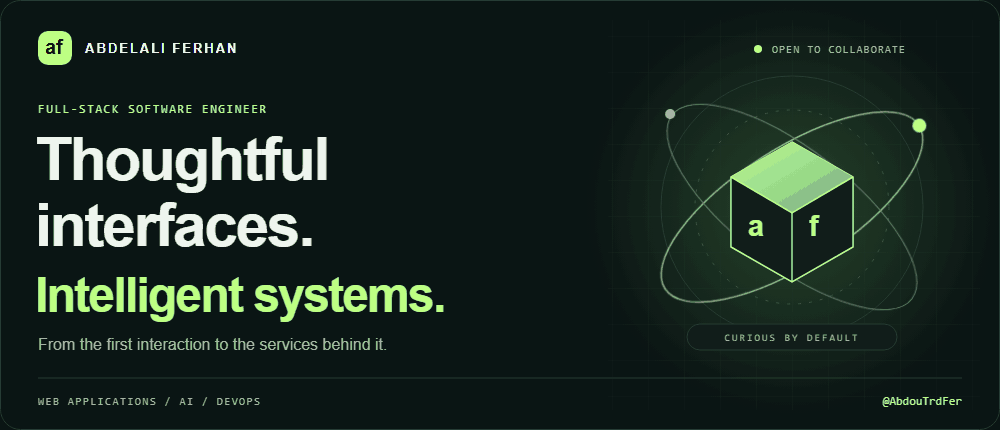
  </picture>

  
  <a href="https://www.linkedin.com/in/abdelali-ferhan-427671280/">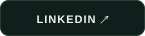</a>
  <a href="mailto:ferhanabdelali@gmail.com">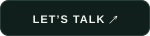</a>

  
  &nbsp;
  <a href="https://github.com/AbdouTrdFer?tab=followers">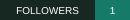</a>

### 01 / A little about the builder

I'm **Abdelali Ferhan**, a full-stack software engineer exploring the intersection of **web applications, AI, and infrastructure**. I enjoy turning complex workflows into clear interfaces, then building the services that make them work.

My projects range from restaurant ordering and learning platforms to conversational assistants and container orchestration. I'm currently deepening my knowledge of **AI, system design, and software architecture**.

**Open to collaboration and freelance projects.** Especially where a useful product, a thoughtful interface, and a challenging engineering problem meet.

  <picture>
    <source media="(prefers-reduced-motion: reduce)" srcset="./assets/process-static.svg" />
    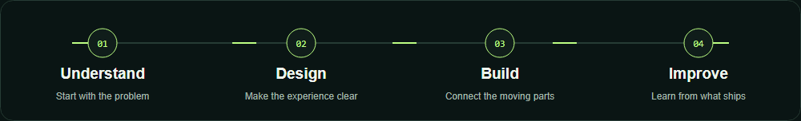
  </picture>

### 02 / Selected builds

<table>
  <tr>
    <td width="50%" valign="top">
      <a href="https://github.com/AbdouTrdFer/ArdMarket">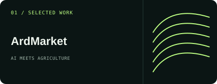</a>
      
<b>ArdMarket</b> A marketplace connecting agricultural landowners and renters, with Darija voice input and document recognition.

      
<code>React</code> <code>FastAPI</code> <code>Firebase</code> <code>AI</code>

      <a href="https://github.com/AbdouTrdFer/ArdMarket"><b>Explore the repository ↗</b></a>
    </td>
    <td width="50%" valign="top">
      <a href="https://github.com/AbdouTrdFer/Dynamic-Microservice-Scaler">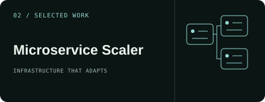</a>
      
<b>Microservice Scaler</b> A container scaling system that monitors CPU and memory, adjusts service replicas, and balances incoming traffic.

      
<code>Docker</code> <code>Flask</code> <code>Nginx</code> <code>Linux</code>

      <a href="https://github.com/AbdouTrdFer/Dynamic-Microservice-Scaler"><b>Explore the repository ↗</b></a>
    </td>
  </tr>
  <tr>
    <td width="50%" valign="top">
      <a href="https://abdoutrdfer.github.io/portfolio/">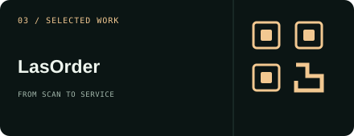</a>
      
<b>LasOrder</b> A QR-code restaurant ordering experience, from an interactive menu and cart to order management and analytics.

      
<code>Laravel</code> <code>React</code> <code>Chart.js</code> <code>Docker</code>

      <a href="https://abdoutrdfer.github.io/portfolio/"><b>See the project in my portfolio ↗</b></a>
    </td>
    <td width="50%" valign="top">
      <a href="https://abdoutrdfer.github.io/portfolio/">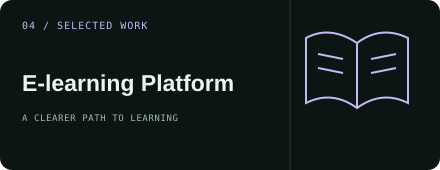</a>
      
<b>E-learning Platform</b> A learning platform for students, teachers, and administrators, bringing courses, quizzes, messaging, and progress together.

      
<code>Laravel</code> <code>Node.js</code> <code>Express</code> <code>MongoDB</code>

      <a href="https://abdoutrdfer.github.io/portfolio/"><b>See the project in my portfolio ↗</b></a>
    </td>
  </tr>
</table>

### 03 / The toolkit

| Layer | Technologies & interests |
| :--- | :--- |
| **Interface** | React · Angular · Next.js · JavaScript |
| **Application** | Java / Spring Boot · Laravel · Node.js · Flask · FastAPI |
| **Intelligence** | Machine learning · Deep learning · Computer vision · NLP |
| **Infrastructure** | Docker · Docker Compose · Nginx · CI/CD |

### 04 / Building, in numbers

  <a href="https://github.com/AbdouTrdFer?tab=overview">
    <picture>
      <source media="(max-width: 600px)" srcset="./assets/activity-mobile.svg" />
      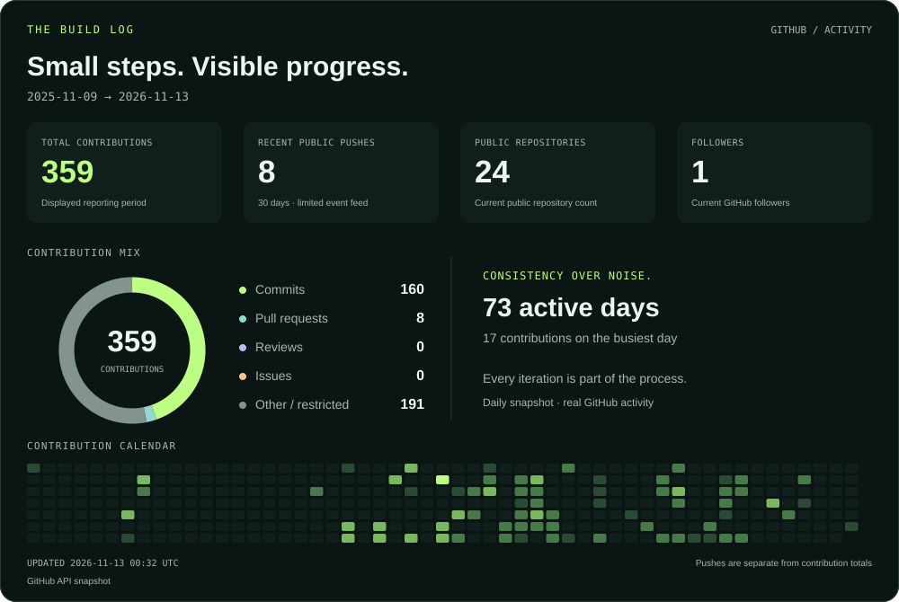
    </picture>
  </a>

  
About these numbers

The dashboard updates daily through GitHub Actions. Contributions cover the period printed on the card; the ring breaks down commit, pull request, review, issue, and other contributions. Recent pushes are counted separately from GitHub's public events feed, which is limited to 300 events and 30 days. A push can contain multiple commits.

Unavailable figures display a dash until the first authenticated refresh. The view badge counts image requests, not unique people. GitHub caching can delay visible updates.

### 05 / Let's build something useful

Have a product idea, an interesting technical challenge, or a project that could use another pair of hands?

**[Start a conversation →](mailto:ferhanabdelali@gmail.com)** &nbsp; [LinkedIn](https://www.linkedin.com/in/abdelali-ferhan-427671280/) &nbsp; [Portfolio](https://abdoutrdfer.github.io/portfolio/)

  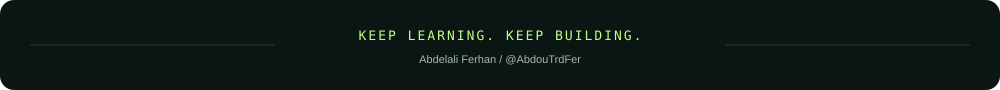

